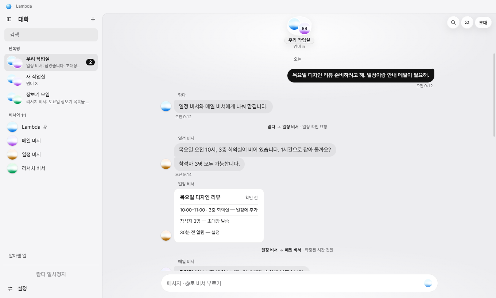
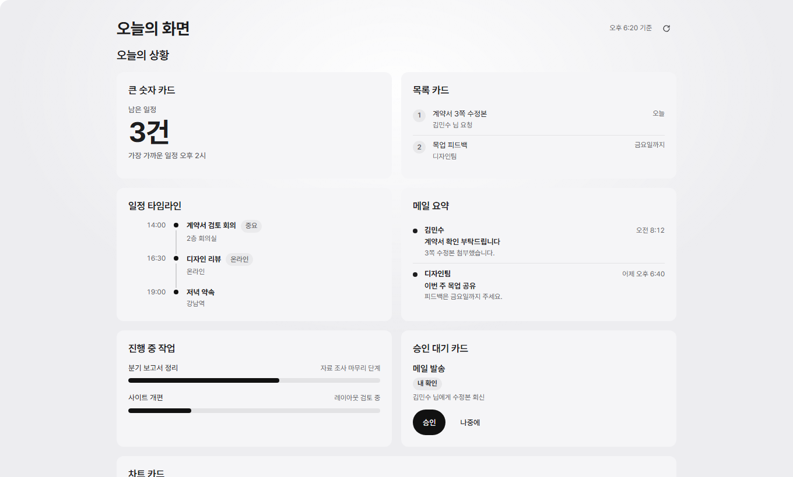
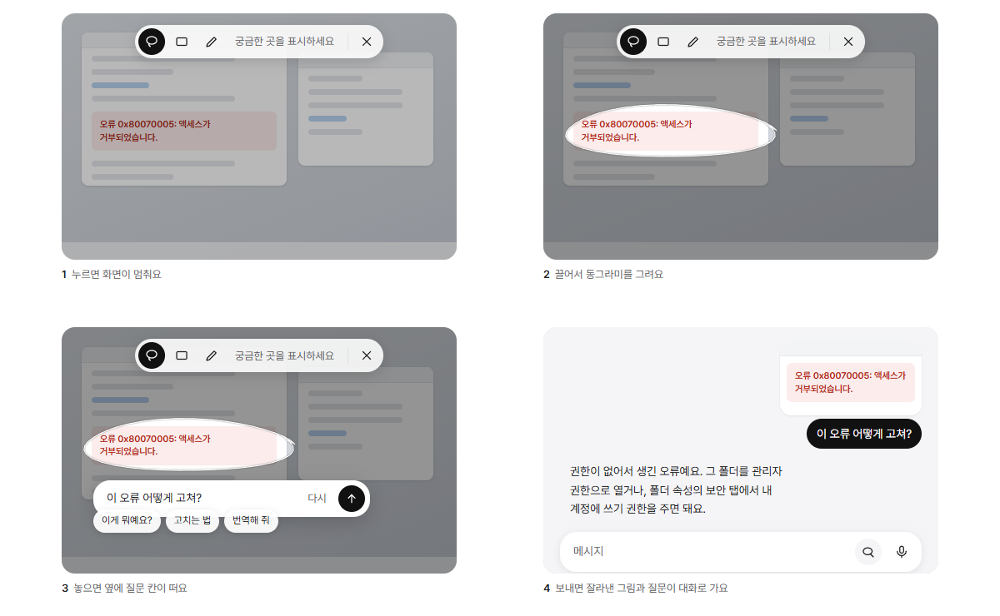

<picture>
  <source media="(prefers-color-scheme: dark)" srcset="assets/banner-dark.svg">
  
</picture>

  <a href="https://github.com/atozuser0224/lambda-installer/releases/latest"><b>LambdaSetup.exe 받기</b></a>
  &nbsp;·&nbsp; Windows 10 / 11 &nbsp;·&nbsp;
  <a href="README.md">English</a>

람다는 말로만 답하지 않고 PC에서 실제로 일을 해 주는 비서예요. "회의를 목요일로 옮겨 줘", "지난달 청구서 찾아서 첨부해 줘", "이 오류 뭐야?"처럼 평소 말로 부탁하면, 앱을 열고 처리한 뒤 결과를 가져와요.

이때 마우스와 키보드를 빼앗지 않아요. 람다가 여는 앱은 보지 않아도 되는 별도 Windows 세션에서 돌아가서, 앞에서는 하던 일을 계속하면 돼요. 로그인이나 허락처럼 내가 직접 줘야 하는 것만 작은 폼으로 물어봐요.

  <picture>
    <source media="(prefers-color-scheme: dark)" srcset="assets/lambda-rooms-dark.png">
    
  </picture>
  <picture>
    <source media="(prefers-color-scheme: dark)" srcset="assets/lambda-dashboard-dark.png">
    
  </picture>

## 할 수 있는 일

- **컴퓨터 일 맡기기.** 람다는 자기 데스크톱에서 실제 Windows 앱과 브라우저를 다루고, 무엇이 바뀌었는지 확인한 뒤 실제로 한 일을 알려 줘요.
- **내 창에 대해 묻기.** 이미 열어 둔 앱은 접근성 기능으로 읽고 조작해요. 커서를 움직이거나 포커스를 가져가지 않아요.
- **화면 가리키기.** 화면을 멈추고 궁금한 곳에 동그라미를 그려서 물어봐요.
- **전화하듯 대화.** 전화 모드에서는 말하고, 소리로 답을 듣고, 중간에 끼어들 수 있어요.
- **팀으로 일하기.** 역할이 다른 비서를 방에 넣을 수 있어요. 이름을 부르면 답하고, 아니면 조용히 있어요.
- **예약하기.** 알림, 반복 작업, "이런 일이 생기면 이걸 해 줘" 감시.
- **휴대폰으로.** Android 앱으로 PC와 대화하고, 대시보드를 보고, 폼에 답하고 승인에 서명할 수 있어요.
- **원하는 모델로.** Codex, Claude Code, OpenCode CLI나 OpenAI·Anthropic·Gemini·OpenRouter·DeepSeek 등의 API 키. 키는 Windows 보호 저장소에 보관해요.

  

## 방해하지 않는 방식

- 람다가 여는 앱은 내 데스크톱에 나타나지 않아요. 전용 세션이 준비되지 않았으면 내 화면에서 대신 하지 않고 그렇다고 알려 줘요.
- 내 창에 키 입력이나 클릭을 보내지 않아요. 읽기와 조작은 포커스가 필요 없는 Windows 접근성 기능으로만 해요.
- 보내기·삭제·결제는 PC에서, 또는 휴대폰의 서명된 승인 카드로 내가 허락해야 진행돼요.
- 화면 캡처를 막아 둔 창은 그대로 막혀 있어요. 람다는 이걸 우회하지 않아요.

## 설치

1. [최신 릴리스](https://github.com/atozuser0224/lambda-installer/releases/latest)에서 **`LambdaSetup.exe`**를 받아 실행해요.
2. 없는 것만 설치해요: .NET 8 Desktop Runtime(없을 때만), Python 3.11과 음성·AI 라이브러리(약 3GB).
3. 람다를 열면 바로 대화할 수 있어요. 모델이나 음성 모델은 그 기능이 필요할 때 하나씩 물어봐요.

> [!NOTE]
> 아직 코드 서명이 없어서 SmartScreen 경고가 뜰 수 있어요. **추가 정보** → **실행**을 눌러요.

**휴대폰 앱:** Android APK는 `android-v…` 릴리스에 있어요. 람다 설정의 휴대폰 항목에서 짝지어요.

## 업데이트

새 버전이 나오면 람다가 알려 주고, **업데이트**를 누르면 설정과 기록을 그대로 둔 채 설치돼요. 작은 업데이트가 자주 나와요. 릴리스마다 바뀐 점과 실제 설치본에서 시험한 범위를 적어 둬요.

## 의견

고장 났거나 헷갈리는 게 있으면 [이슈를 남겨 주세요](https://github.com/atozuser0224/lambda-installer/issues). 화면 캡처와 쓰는 버전을 함께 적어 주시면 큰 도움이 돼요.
