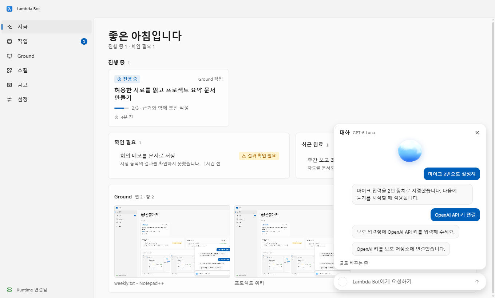
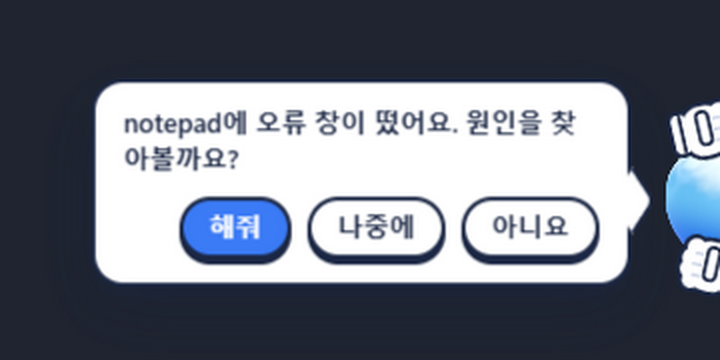
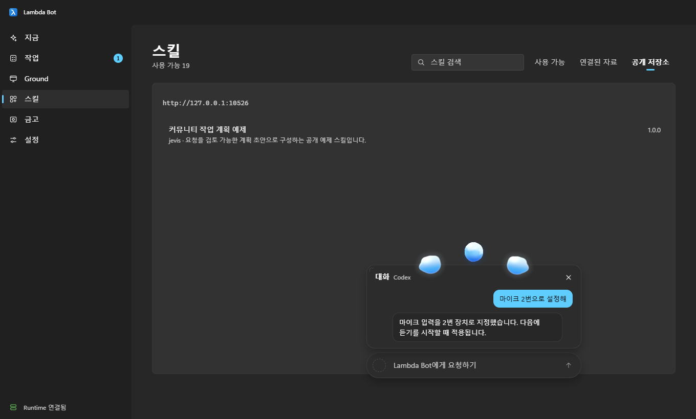
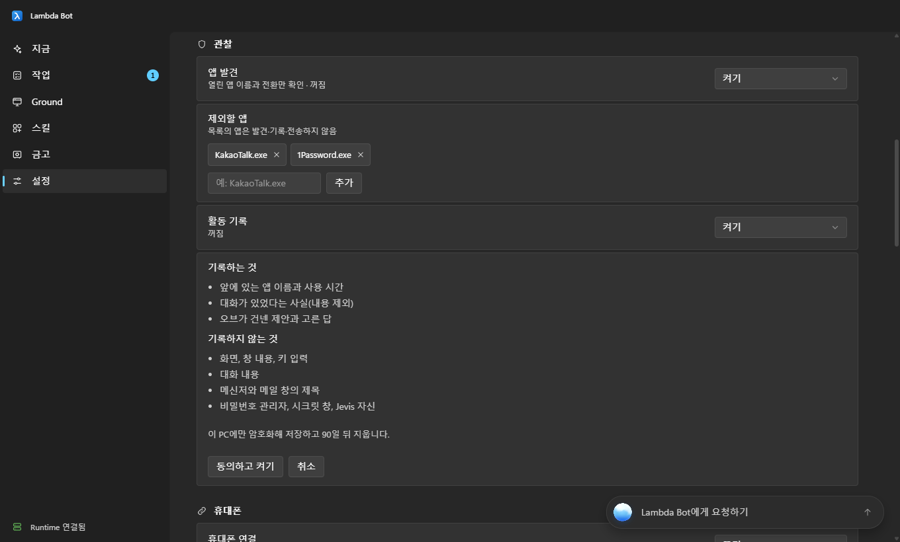

# Lambda Bot

### Windows용 백그라운드 어시스턴트

**조용히 뒤에서 일하고, 도움이 필요해 보이면 알아채고, 언제나 먼저 물어봅니다.**

[English](README.md) · **한국어**

 

 

## Lambda Bot이 뭔가요?

Lambda Bot은 브라우저 탭이 아니라 내 PC 안에 사는 어시스턴트입니다. 작업표시줄에 작은 **오브**가 떠 있고, 말이나 글로 부탁하면 내가 고른 모델과 도구로 일을 처리합니다. 일은 뒤에서 돌아가므로 지금 하던 작업은 끊기지 않습니다.

허락하면 지켜보기도 합니다. 방금 오류 창이 떴다거나 막힌 것처럼 보이면 오브가 빼꼼 나와서 **도와드릴까요?** 하고 먼저 묻습니다. 한 번 클릭으로 답하면 되고, 몰래 하는 일은 없습니다.

 오브의 제안. 해줘는 실행, 나중에는 30분 뒤에 다시 묻고, 아니요는 하루 동안 기억합니다.

## 주요 기능

|   |   |
|---|---|
| **채팅 탭이 아니라 음성 오브** | 말하거나 입력하세요. 오브가 대화를 따라다니며 듣고, 생각하고, 작업하던 그 자리에서 답합니다. |
| **행동하기 전에 먼저 묻기** | 도움은 질문으로 나옵니다. 무언가를 바꾸는 작업은 미리 허용해 두지 않았다면 먼저 승인을 받고, 승인은 그 작업 한 번에만 유효합니다. |
| **백그라운드에서 작업** | 앱은 숨겨진 창에서 조작해서, 화면 앞으로 튀어나오거나 타이핑을 가로채지 않습니다. |
| **원하는 모델 그대로** | OpenAI, Anthropic, Gemini, OpenRouter, DeepSeek, Groq, xAI, Mistral 등과 이미 쓰는 CLI(Codex, Claude Code, OpenCode)를 연결합니다. 키는 Windows 보호 저장소에만 보관합니다. |
| **스킬** | 자료 조사, 문서 작성, 프로젝트 점검·수정, 메모, Discord 초안용 기본 스킬이 들어 있고 커뮤니티 저장소에서 더 추가할 수 있습니다. |
| **휴대폰이 리모컨** | 같은 Wi-Fi에서 QR 코드를 찍으면 휴대폰으로 PC의 어시스턴트와 대화합니다. |
| **내 마음대로 배치** | 대화창을 아무 데나 끌어 놓고, 크기를 바꾸고, 아주 작게 줄이면 오브만 남습니다. |

 대화창을 옮기거나 키우면 오브가 붙잡아 줍니다.

## 개인정보는 기본부터 지킵니다

제안이 때에 맞도록 지금 하는 일을 알 수 있지만, 내가 허락했을 때만, 필요한 만큼만 합니다.

- **직접 켤 때만.** 설정에서 동의하기 전에는 아무것도 기록하지 않고, 언제든 일시정지하거나 전부 지울 수 있습니다.
- **앱 이름과 시간만.** 어떤 앱이 앞에 있었는지와 시간만 기록합니다. 화면, 창 내용, 키 입력, 내가 한 말은 **기록하지 않습니다**.
- **민감한 곳은 건너뜁니다.** 메신저·메일 창의 제목은 남기지 않고, 비밀번호 관리자, 시크릿 창, Lambda Bot 자신은 제외합니다.
- **내 PC 안에만.** 기록은 Windows로 암호화해 저장하고 90일 뒤 지웁니다.
- **조용해야 할 때는 조용히.** 전체화면, 발표, 자리 비움 중에는 먼저 말을 걸지 않고, 오브의 말풍선은 화면 캡처에 보이지 않습니다.

## 설치

1. [최신 릴리스](https://github.com/atozuser0224/jevis-installer/releases/latest)에서 **`JevisSetup.exe`**를 받아 실행합니다.
2. 설치할 항목을 고르면 없는 것만 받아서 설치합니다.
   - Lambda Bot (필수)
   - .NET 8 Desktop Runtime (없을 때만)
   - Python 3.11 + 음성·AI 라이브러리 (필수, 약 3GB)
   - 바탕 화면 바로가기
3. Lambda Bot을 실행하고 첫 실행 화면을 따라 하세요. 음성 모델은 여기서 받고, 모델 제공자나 이미 쓰는 CLI를 연결합니다.

**요구 사항:** Windows 10 또는 11

> [!NOTE]
> 설치 프로그램에 아직 코드 서명이 없어 Windows SmartScreen이 경고할 수 있습니다. **추가 정보**를 누른 뒤 **실행**을 선택하세요.

Lambda Bot은 예전에 Jevis라는 이름이었어서, 설치 파일과 설치 폴더에는 아직 그 이름이 남아 있습니다.

## 업데이트

Lambda Bot이 이 페이지의 새 릴리스를 확인해서 앱 안에서 알려 줍니다. **업데이트**를 누르면 같은 폴더에 최신 버전을 받아 설치합니다.

## 의견 보내기

버그나 아이디어가 있나요? [이슈를 남겨 주세요](https://github.com/atozuser0224/jevis-installer/issues).

 
Lambda Bot · Windows용 백그라운드 어시스턴트

