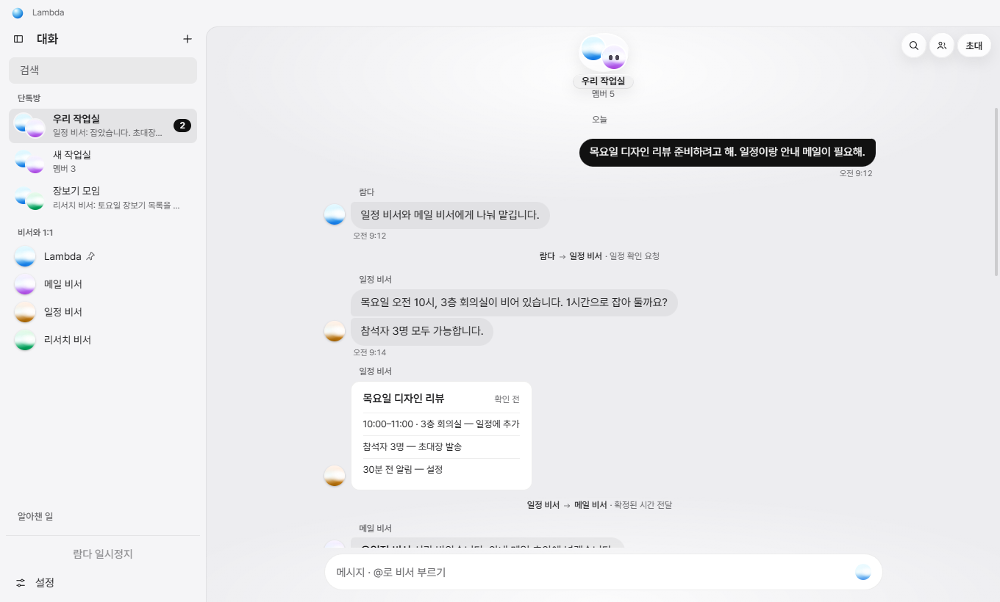
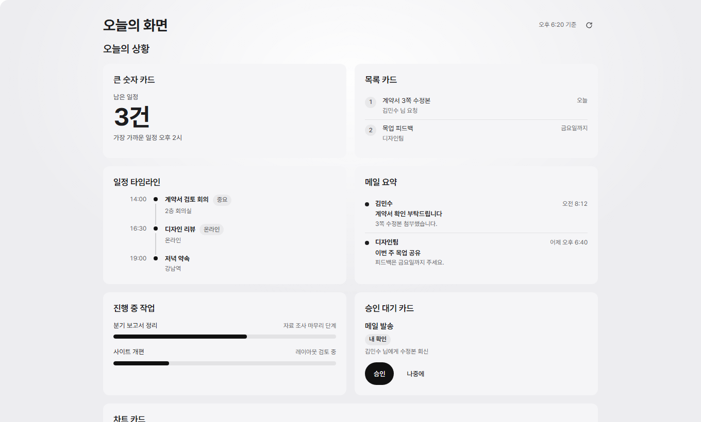
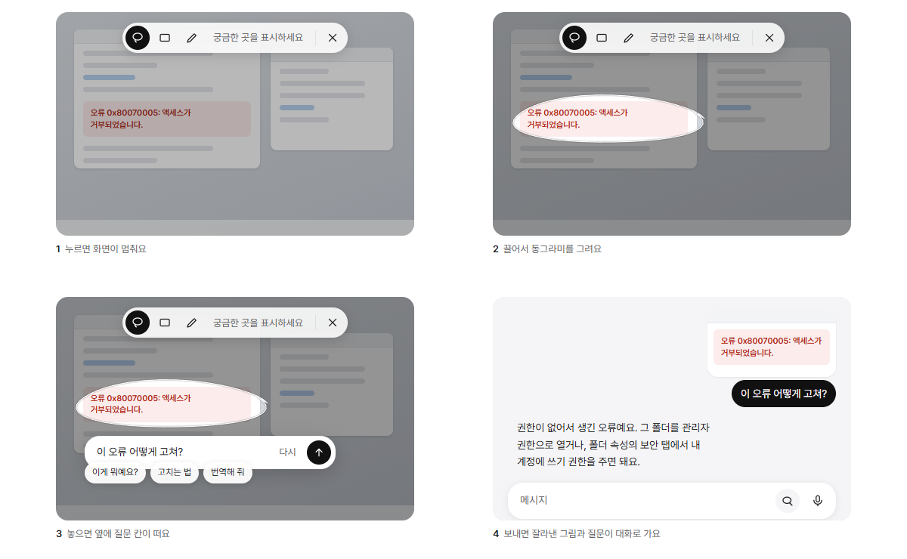

<picture>
  <source media="(prefers-color-scheme: dark)" srcset="assets/banner-dark.svg">
  
</picture>

  <a href="https://github.com/atozuser0224/lambda-installer/releases/latest"><b>Download LambdaSetup.exe</b></a>
  &nbsp;·&nbsp; Windows 10 / 11 &nbsp;·&nbsp;
  <a href="README.ko.md">한국어</a>

Lambda is an assistant that does things on your PC, not just talks about them. Ask in plain words — "move the meeting to Thursday", "find last month's invoice and attach it", "what's this error?" — and it opens the apps, works through them and brings back the result.

It does that without borrowing your mouse or keyboard. Apps Lambda opens run in a separate Windows session you never have to look at, so you can keep typing in front while it works behind. When it needs something only you can give, like a login or a yes, it asks with a small form.

  <picture>
    <source media="(prefers-color-scheme: dark)" srcset="assets/lambda-rooms-dark.png">
    
  </picture>
  <picture>
    <source media="(prefers-color-scheme: dark)" srcset="assets/lambda-dashboard-dark.png">
    
  </picture>

## What you can do with it

- **Hand off computer work.** Lambda drives real Windows apps and a browser in its own desktop, checks what changed, and tells you what it actually did — not what it hoped happened.
- **Ask about your own windows.** For apps you already have open, it reads and operates them through accessibility patterns, without moving your cursor or stealing focus.
- **Point at things.** Freeze the screen, circle what you mean, and ask about it.
- **Talk to it.** Call mode lets you speak, hear the answer, and cut in while it's talking.
- **Work with a team.** Add assistants with their own roles to a room. They answer when you name them and stay quiet otherwise.
- **Keep it on a schedule.** Reminders, recurring jobs, and "when this happens, do that" watches.
- **Use your phone.** The Android app chats with your PC, shows the dashboard, and lets you answer forms and sign approvals away from your desk.
- **Bring your own models.** Codex, Claude Code and OpenCode CLIs, or API keys for OpenAI, Anthropic, Gemini, OpenRouter, DeepSeek and others. Keys are kept in Windows' protected storage.

  

## How it stays out of your way

- Nothing Lambda launches appears on your desktop. If its private session isn't ready, it says so instead of falling back to your screen.
- It never sends keystrokes or clicks to your windows. Reading and acting on them goes through Windows accessibility, which doesn't need focus.
- Anything that sends, deletes or pays waits for your approval — on the PC, or as a signed card on your phone.
- Windows that block screen capture stay blocked. Lambda doesn't work around them.

## Install

1. Download **`LambdaSetup.exe`** from the [latest release](https://github.com/atozuser0224/lambda-installer/releases/latest) and run it.
2. The installer adds what's missing: the .NET 8 Desktop Runtime if you don't have it, and Python 3.11 with the voice and AI libraries (about 3 GB).
3. Open Lambda. The first screen gets you talking right away; it asks for a model or a speech model only when a feature needs one.

> [!NOTE]
> Builds aren't code-signed yet, so SmartScreen may warn you. Choose **More info**, then **Run anyway**.

**Phone app:** the Android APK is in the releases tagged `android-v…`. Pair it from the phone section in Lambda's settings.

## Updates

Lambda checks this page and tells you when a new version is out; **Update** installs it in place and keeps your settings and history. Releases are frequent and small — each one lists what changed and what was tested on a real install.

## Feedback

Something broken or confusing? [Open an issue](https://github.com/atozuser0224/lambda-installer/issues). A screenshot and the version you're on help a lot.
